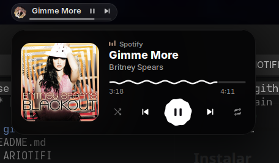

# ARIOTIFI

Proyecto de **Diego Esparza (ARIOT117)** · [Licencia MIT](LICENSE)

Personalización de **Spotify Desktop para Linux**, con un widget opcional para GNOME 50 y Spicetify: interfaz VideoGlass, fondo basado en la portada, vista inmersiva con letras sincronizadas, visualizador de audio real, controles florales y progreso ondulado.

Este repositorio reúne el código que estaba instalado al preparar la entrega, su configuración reproducible, los diseños anteriores, capturas y el historial Git original. Spotify y Spicetify se instalan por separado.


## Qué hace

- Inicio oscuro con transparencias y dock flotante de reproducción.
- Vista inmersiva dentro de la ventana; pantalla completa opcional desde el menú.
- Portada floral, transición floral y componentes FlowerButton y WavyProgress.
- Fondo difuminado de la portada y acentos que cambian con la canción.
- Visualizador de 72 barras, alimentado por el monitor de salida del equipo mediante GStreamer. No usa el micrófono; puede reaccionar al sonido de otras aplicaciones.
- Letras de LRCLIB, seguimiento de la línea actual, salto al pulsar un verso y estados de carga, instrumental o sin letra.
- Reproducción, posición, volumen, aleatorio y repetición mediante MPRIS/D-Bus; temporizador, modo compacto y ajustes visuales.
- Widget opcional **Flower Music** para el panel de GNOME 50, con portada y controles MPRIS: [instalación y configuración](widget/README.md).
- Adaptación a ventanas pequeñas y respeto de la preferencia de movimiento reducido.

No incluye el cliente de Spotify, contraseñas, cookies, tokens, preferencias privadas ni cachés de canciones. Las funciones de la cuenta siguen dependiendo de Spotify. Las letras requieren conexión y disponibilidad en LRCLIB.

## Fotos y diseños

Las imágenes son capturas reales guardadas durante el desarrollo, principalmente del 17 y 18 de octubre de 2026; muestran estados de distintas revisiones. Los controles y el fondo recibieron ajustes posteriores que están en el código principal. [Galería con más fotos](docs/GALERIA.md).


El widget del panel también está incluido:



## Instalar

Entorno probado durante el desarrollo: **Spotify 1.2.95.453.g0eeebbed**, **Spicetify 2.45.3**, Ubuntu/GNOME, systemd de usuario y salida de audio compatible con PulseAudio. Otras versiones pueden requerir adaptar los selectores CSS o las APIs de Spotify.

1. Sigue [la preparación del cliente y dependencias](docs/INSTALACION.md). Si usas Snap, prepara una copia escribible; el Snap es de solo lectura.
2. Desde esta carpeta, con Spotify cerrado y desde una terminal de tu sesión gráfica:

```bash
./install.sh --check
./install.sh
```

El instalador usa tu carpeta personal, conserva la sección `[Backup]` y otras extensiones de Spicetify, respalda los archivos que reemplaza y registra la aplicación **ARIOTIFI**. No necesita sudo ni descarga dependencias. Si usas otras rutas:

```bash
./install.sh --spotify-path "$HOME/ruta/al/cliente" --prefs-path "$HOME/.config/spotify/prefs"
```

Abre **ARIOTIFI** desde el menú o ejecuta `~/.local/bin/spotify-personalizado`. Pulsa **Inmersiva**, la portada del dock o **Ctrl + Alt + V**. **Esc** vuelve a la biblioteca; **Espacio** pausa/reproduce. Cierra antes otras instancias de Spotify para evitar que el cliente reutilice la sesión equivocada.

- [Instalación manual completa](docs/INSTALACION.md#instalacion-manual).
- [Instalación con ayuda de un CLI de IA: prompt listo para copiar](docs/CON-IA.md).
- [Diagnóstico y restauración](docs/INSTALACION.md#diagnostico-y-restauracion).

## Qué contiene

| Ruta | Contenido |
| --- | --- |
| `Extensions/` | VideoGlass y componentes originales FlowerButton/WavyProgress; el bundle ya incorpora ambos componentes. |
| `VideoGlass/` | CSS y paleta del tema activo. |
| `visualizer.py` | Servicio local de audio, letras y controles MPRIS, en `127.0.0.1:43891`. |
| `widget/` | Flower Music: código y diseño del widget del panel, instalación y restauración opcionales. |
| `config/` | Configuración de ejemplo sin estado de respaldo, servicio y lanzador. |
| `install.sh`, `apply.sh`, `revert.sh`, `scripts/` | Instalación, actualización y restauración para el usuario actual. |
| `docs/capturas/` | Capturas reales del desarrollo, ventanas pequeñas y detalles de controles. |
| `archive/` | VideoGlass del 11 de octubre, malla, halo, fotogramas de referencia y fuentes de etapas anteriores. |
| `tests/`, `measurements/` | Herramientas y evidencia de desarrollo; varias pruebas históricas requieren una sesión preparada. |
| `docs/historial/` | Documentación original y lista de commits anteriores. |

## Consumo medido con Pulso

[Resultados y capturas reales del widget](docs/RENDIMIENTO.md). La prueba distingue GNOME Shell, todos los procesos de Spotify y el puente de audio. La reproducción cambió entre fases y no permite aislar el coste adicional de Flower Music; no equivale a una comparación de Spotify original con VideoGlass.

## Verificación y límites

El código visual y el backend principal se copiaron sin cambios de la versión instalada. La comprobación de integridad se registra en [PROVENIENCIA.md](docs/PROVENIENCIA.md). Para validar la entrega sin abrir Spotify:

```bash
python3 -m unittest discover -s tests -p 'test_*.py'
python3 scripts/verify.py
```

La [auditoría histórica](AUDITORIA-FINAL.md) conserva los resultados de rendimiento: **las metas globales de RAM y CPU quedaron pendientes**. No se promete un ahorro de memoria. Las mediciones pertenecen al equipo y revisiones descritos en ese informe.

Las pruebas interactivas históricas usan el puerto de depuración 9222, cambian reproducción o archivos instalados y algunas conservan rutas del equipo original. Consulta [tests/README.md](tests/README.md) antes de ejecutarlas. No forman parte de la instalación.

## Créditos

Proyecto de **Diego Esparza (ARIOT117)**. Herramientas y servicios: [Spicetify CLI](https://github.com/spicetify/cli), [LRCLIB](https://lrclib.net), GStreamer y MPRIS. La documentación histórica describe las referencias visuales de @shred0s y los componentes aportados durante el trabajo. Las portadas, marcas, letras y referencias visuales pertenecen a sus titulares. No se ha asignado una licencia nueva a material de terceros ni se incluyen binarios de Spotify.

## Licencia y autoría

El código original de ARIOTIFI se publica bajo la [licencia MIT](LICENSE).

**Copyright (c) 2026 Diego Esparza (ARIOT117).**

Cualquiera puede usar, copiar, modificar, distribuir y vender copias del código, incluso en proyectos comerciales. Al distribuir copias o partes sustanciales deben conservar este aviso de copyright y el texto de la licencia MIT. Esa es la atribución exigida por la licencia; no obliga a mostrar un crédito en pantalla ni a publicar las modificaciones con la misma licencia.

La licencia se aplica a las aportaciones originales sobre las que el autor tiene derechos. Las portadas, marcas, letras, referencias y demás material de terceros conservan sus derechos y condiciones propios: consulta [los avisos y créditos](NOTICE.md). Texto de referencia: [MIT en Open Source Initiative](https://opensource.org/license/mit).
