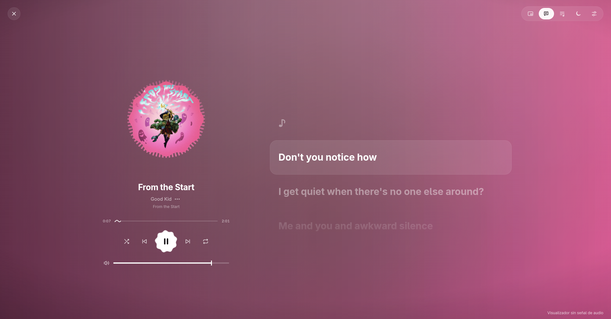
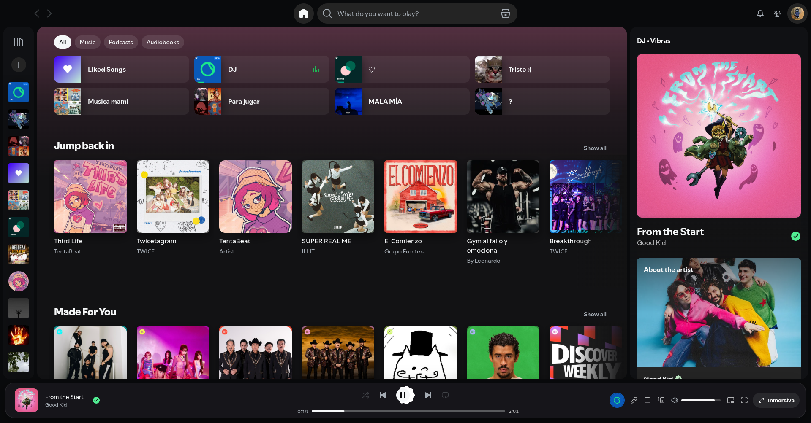
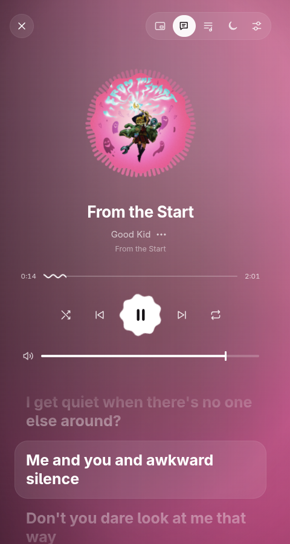
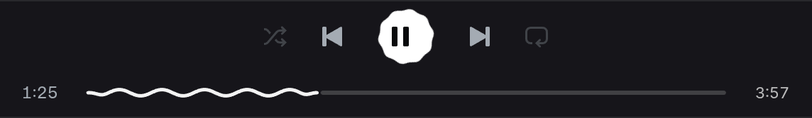
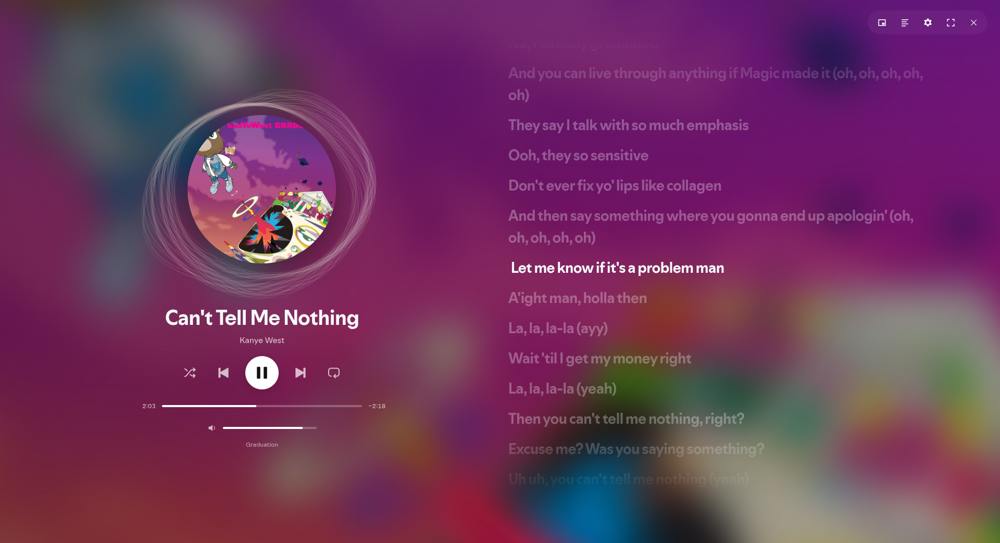
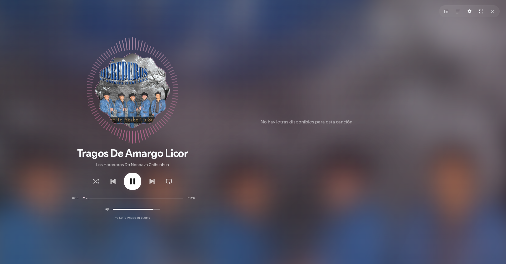
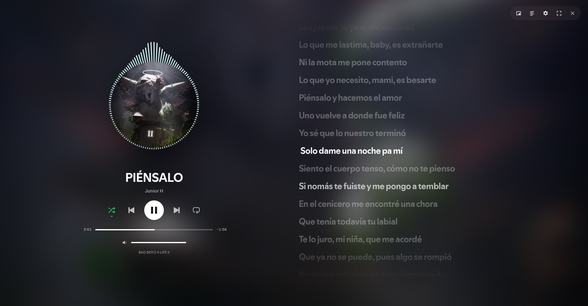

# Fotos y evolución del diseño

Capturas reales archivadas durante el desarrollo. Cada imagen representa su revisión de origen, no una captura nueva de esta entrega.

## VideoGlass premium

Vista inmersiva con letras y portada floral:

Biblioteca con dock flotante:

Ventana estrecha:

Detalle de controles, del pase de auditoría al 200%:

## Diseños anteriores

Malla abstracta reactiva, 15 de octubre:

Halo y efectos de la referencia del 17 de octubre:

Primera vista con letras y controles grandes, 11 de octubre:

Las fuentes iniciales están en `archive/videoglass-2026-10-11/`. Los respaldos de código están en `archive/etapas/`. Los contactos y fotogramas de las referencias originales se guardan en `archive/referencias/`, `archive/efectos-referencia-2026-10-17/` y `archive/transicion-fotogramas/`. Los diseños históricos no se instalan automáticamente junto con el tema principal.
