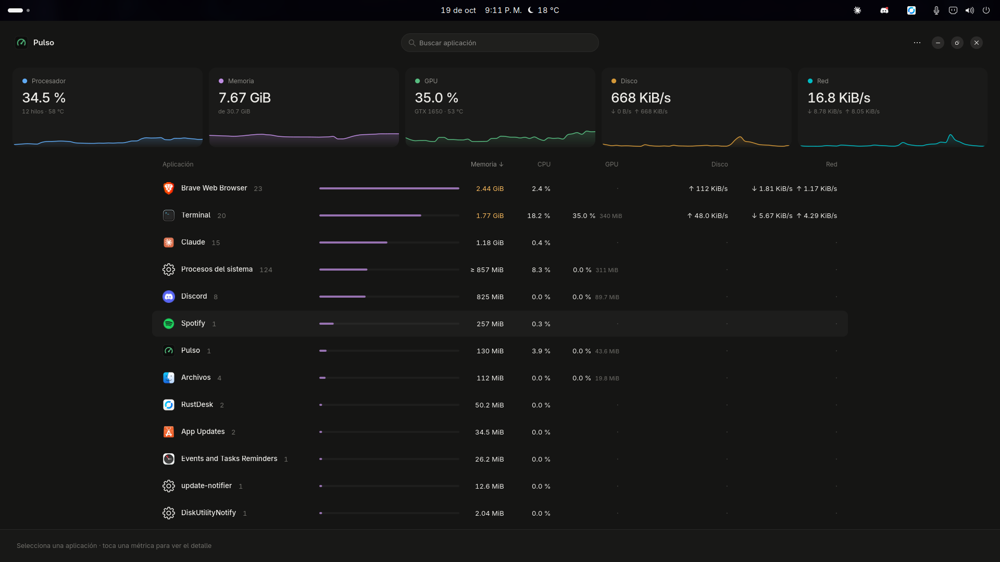
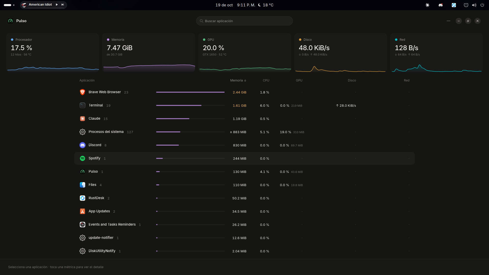
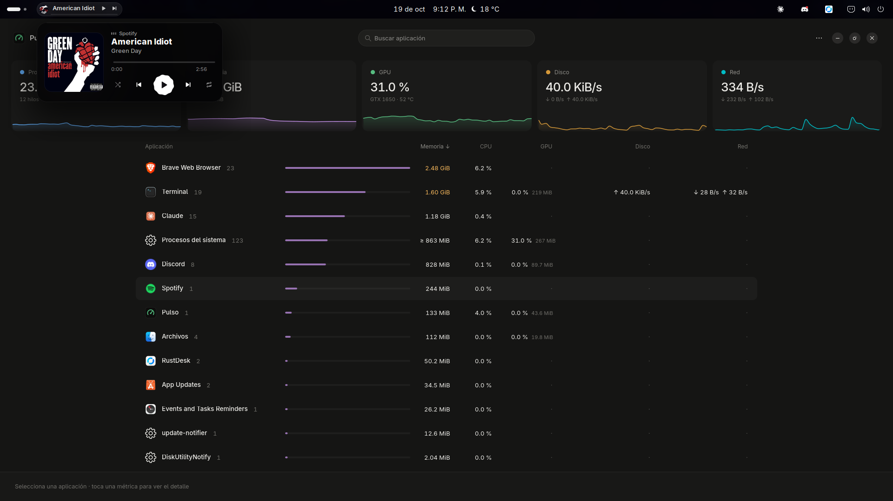

# Consumo real: Flower Music y Spotify

La prueba del 19 de octubre de 2026 usa el recolector del propio [Pulso](https://github.com/ARIOT117/pulso), con su interfaz abierta, y guarda los datos originales. Las capturas muestran la aplicación real, no una recreación.

## Qué compara

La prueba alterna el widget Flower Music en la misma sesión de GNOME para observar el consumo. Como la reproducción y la carga cambiaron, no permite aislar su coste adicional con fiabilidad. Spotify, VideoGlass y el servicio Python permanecen instalados en todas las fases. Por tanto, no es una comparación entre Spotify original y Spotify personalizado y no demuestra que toda la personalización tenga impacto cero.

La extensión vive dentro de `gnome-shell`. Su memoria y CPU no aparecen como una aplicación separada en Pulso. Spotify se mide sumando todos sus procesos identificados por su ejecutable, y el puente Python se suma aparte, incluido el proceso de captura de audio. En estas capturas, la fila «Spotify» de la interfaz identifica solo un proceso; varios hijos se agrupan bajo «Terminal» por la forma de lanzamiento. Por eso **la cifra de esa fila no es la memoria total de Spotify**. La tabla de abajo suma los procesos del cliente independientemente de cómo los agrupa la interfaz.

Se ejecutan cinco fases: widget desactivado, cerrado, abierto, cerrado de nuevo y desactivado de nuevo. Cada fase tiene 5 s de estabilización y 10 muestras del recolector, separadas por 2 s, más el tiempo de recolección. El estado del desplegable se comprueba antes y después. No se cambian canciones ni se fuerza una recolección de basura. La reproducción puede avanzar de pista de forma natural; los URI y el estado se guardan junto con las muestras.

El desplegable se mantiene abierto durante su fase retirándolo temporalmente del gestor de captura de entrada y evitando su cierre por clics fuera. Esto conserva sus animaciones y consultas sin bloquear las otras aplicaciones. La instrumentación solo se importa para esta prueba y se retira al terminar.

CPU se expresa como porcentaje de **todo el equipo**, igual que el modo predeterminado de Pulso; un núcleo completo en un equipo de 12 hilos es aproximadamente 8,33%. Memoria es **PSS**, que reparte las páginas compartidas entre procesos. Pulso actualiza la PSS de procesos activos aproximadamente cada 5 s y la de inactivos cada 15 s: las lecturas cercanas pueden compartir una muestra de memoria.

## Datos y capturas

Los resultados completos, con todas las muestras y estados, están en [pulso-resultados.json](rendimiento/2026-10-19/pulso-resultados.json). La tabla se calcula a partir de sus medias por fase.

**Resultado: esta sesión no demuestra impacto cero ni permite aislar un coste fijo del widget.** La reproducción cambió entre fases; el desplegable permaneció abierto pero estuvo en pausa durante sus diez muestras, así que no mide el coste de su animación activa. El uso total de Spotify y del escritorio también varió.

| Estado observado | GNOME CPU | GNOME PSS MiB | Spotify CPU total | Spotify PSS MiB | Puente CPU | Puente PSS MiB | Muestras reproduciendo |
| --- | ---: | ---: | ---: | ---: | ---: | ---: | ---: |
| Sin widget, antes | 3.86% | 331.76 | 11.36% | 905.49 | 0.039% | 31.70 | 6/10 |
| Widget cerrado | 5.63% | 358.71 | 7.97% | 1228.33 | 0.066% | 29.39 | 4/10 |
| Widget abierto (en pausa) | 5.24% | 358.89 | 0.85% | 933.54 | 0.008% | 22.05 | 0/10 |
| Widget cerrado, después | 5.40% | 391.53 | 7.48% | 969.98 | 0.016% | 21.97 | 4/10 |
| Sin widget, después | 1.08% | 391.01 | 1.28% | 972.09 | 0.004% | 22.02 | 0/10 |

Las dos líneas base sin widget ya difieren 59.25 MiB de PSS de GNOME Shell. Esa deriva impide atribuir la diferencia de memoria al widget o afirmar ausencia de fugas. La CPU de todo el equipo no equivale al porcentaje de un único núcleo. Las cifras de Spotify incluyen sus nueve procesos en esta ejecución, no solamente la fila parcial de la captura.

Se completaron las 50 muestras y se verificó la restauración de la activación original de Flower Music. Para estimar su sobrecoste con más rigor hace falta repetir con la misma pista y estado de reproducción, la misma carga de escritorio y muestras repetidas; estas imágenes se publican como observación real de uso, no como una garantía de rendimiento.







Las capturas se toman después de las muestras, al presentar Pulso en su monitor. Sus cifras instantáneas pueden diferir de las medias de la tabla. No se alteraron los números ni se generaron imágenes de la interfaz.

## Límites

Son muestras de una sesión caliente con otras aplicaciones y extensiones en uso, no un laboratorio aislado ni una medida de arranque en frío. Las diferencias de `gnome-shell` incluyen el trabajo compartido del compositor y la actividad del escritorio; una bajada de PSS no significa memoria negativa ni ahorro causado por el widget. Las dos líneas base permiten observar parte de esa variación.

La [primera tentativa incompleta](rendimiento/2026-10-19/pulso-intento-incompleto.json) se conserva por transparencia: el menú se cerró antes de terminar la fase abierta y no se utiliza para la tabla final. Sus capturas se descartaron.

La [auditoría histórica de VideoGlass](../AUDITORIA-FINAL.md) sigue vigente como registro de sus revisiones: las metas globales de CPU y RAM quedaron pendientes. No se reemplaza por una promesa de «no afecta al rendimiento». Esta prueba del widget tampoco mide latencia, FPS, batería ni estabilidad durante horas.

## Repetir la prueba

Con Pulso disponible en una copia local, desde una terminal de tu sesión GNOME 50:

```bash
python3 scripts/benchmark-pulso.py --pulso-source /ruta/al/repo/pulso --output /tmp/ariotifi-mi-prueba --samples 10 --interval 2
```

El script abre Pulso, usa Looking Glass mediante una sesión temporal de entrada de Mutter, alterna únicamente Flower Music y restaura el estado del widget al terminar. No habilita `unsafe_mode` ni interfaces D-Bus de depuración. Presenta Pulso para las capturas; si necesitas conservar el foco de otra aplicación, selecciónala al terminar. No se ejecuta durante la instalación de ARIOTIFI.

Si la sesión no permite las APIs locales de Mutter/Looking Glass o no existe el widget, la prueba falla y debe revisarse; no inventa resultados. La instrumentación tiene un límite de tiempo de 10 minutos que restaura la activación si el muestreador deja de responder. Revisa las imágenes antes de compartirlas para confirmar el encuadre de Pulso.
